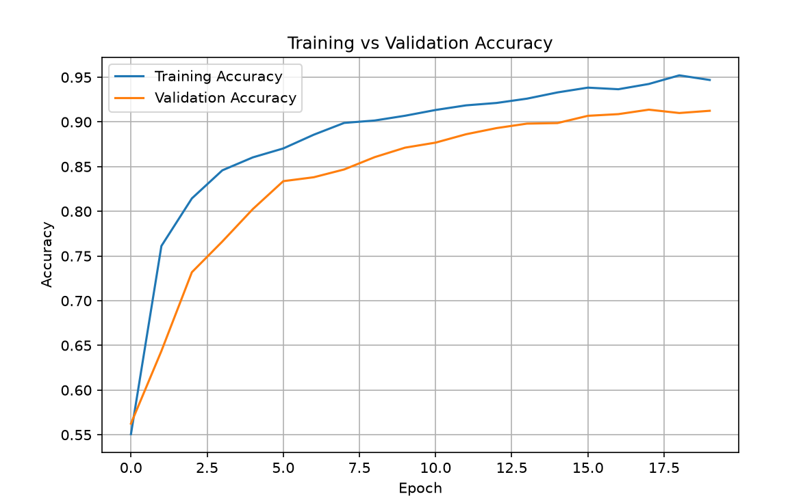
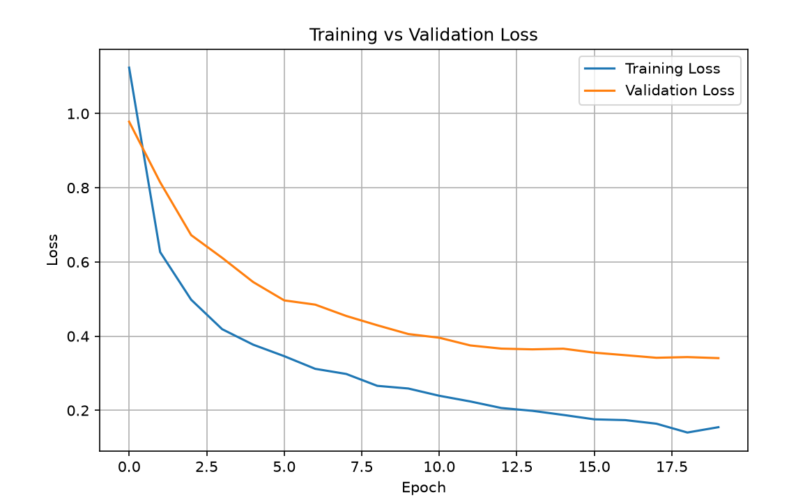

<div align="center">

# 🧠 Brain Tumor Detection Using Deep Learning

**An AI-powered system for classifying brain tumors from MRI scans using MobileNetV2 and Transfer Learning**


</div>

---

## 📑 Table of Contents

- [Overview](#-project-overview)
- [Objective](#-objective)
- [Dataset](#-dataset)
- [Model Architecture](#️-model-architecture)
- [Training Details](#-training-details)
- [Results](#-results)
- [Technologies Used](#️-technologies-used)
- [Project Structure](#-project-structure)
- [Installation & Usage](#-installation--usage)
- [Future Improvements](#-future-improvements)
- [Author](#-author)
- [License](#-license)

---

## 📌 Project Overview

This project is a **Deep Learning-based Brain Tumor Detection System** built with **TensorFlow** and **MobileNetV2**. It classifies MRI brain scans into four categories:

| Category | Description |
|---|---|
| 🔴 Glioma | Tumor arising from glial cells |
| 🟠 Meningioma | Tumor of the meninges |
| 🟡 Pituitary Tumor | Tumor in the pituitary gland |
| 🟢 No Tumor | Healthy brain scan |

The project showcases the application of **Transfer Learning** for high-accuracy medical image classification, aiming to support faster, more reliable diagnostic workflows.

---

## 🎯 Objective

To automatically detect and classify brain tumor types from MRI images using a deep learning model — helping radiologists and clinicians move toward faster, more consistent, and more accurate diagnoses.

---

## 📂 Dataset

The dataset consists of labeled MRI brain images across four classes: **Glioma, Meningioma, Pituitary Tumor,** and **No Tumor**.

| Metric | Value |
|---|---|
| Training Images | 5,600 |
| Testing Images | 1,600 |
| Image Size | 224 × 224 × 3 |
| Number of Classes | 4 |

---

## 🏗️ Model Architecture

The model is built on **MobileNetV2**, pre-trained on ImageNet, using Transfer Learning.

**Base Model**
- MobileNetV2 (`include_top=False`)
- Input Shape: `224 × 224 × 3`
- Pre-trained weights: ImageNet

**Custom Classification Head**
- `GlobalAveragePooling2D`
- `Dropout (0.5)`
- `Dense (4, activation='softmax')`

**Compilation**

| Parameter | Value |
|---|---|
| Optimizer | Adam |
| Learning Rate | 0.00001 |
| Loss Function | Categorical Crossentropy |

---

## 📈 Training Details

| Parameter | Value |
|---|---|
| Epochs | 20 |
| Batch Size | 32 |
| Callbacks | EarlyStopping, ModelCheckpoint |

**Data Augmentation**
- Rescaling
- Rotation
- Zoom
- Horizontal Flip

---

## 📊 Results

### ✅ Test Accuracy: **92%**

### Classification Report

| Class | Precision | Recall | F1-Score |
|---|---|---|---|
| Glioma | 0.94 | 0.78 | 0.86 |
| Meningioma | 0.84 | 0.90 | 0.87 |
| No Tumor | 0.94 | 0.99 | 0.96 |
| Pituitary | 0.95 | 0.98 | 0.97 |
## 📉 Training Graphs

<div align="center">

### Training vs Validation Accuracy


### Training vs Validation Loss


</div>

## 🛠️ Technologies Used

| Category | Tools |
|---|---|
| Language | Python |
| Deep Learning | TensorFlow, Keras |
| Model | MobileNetV2 |
| Data Handling | NumPy, OpenCV |
| Visualization | Matplotlib |
| Evaluation | Scikit-Learn |

---

## 📁 Project Structure

```
Brain-Tumor-Detection/
│
├── train.py                   # Train custom CNN model
├── train_mobilenet.py         # Train MobileNetV2 model
├── evaluate.py                # Evaluate CNN model
├── evaluate_mobilenet.py      # Evaluate MobileNetV2 model
├── predict.py                 # Run inference on new MRI images
├── plot_history.py            # Plot training accuracy/loss curves
├── check_dataset.py           # Validate dataset structure
├── brain_tumor_detection.py   # Core utilities/model definitions
├── test.jpg                   # Sample test image
├── .gitignore
├── README.md
└── models/                    # Saved trained models
```-

## 🚀 Installation & Usage

**1. Clone the repository**
```bash
git clone https://github.com/srishtypancholi-07/Brain-Tumor-Detection.git
cd Brain-Tumor-Detection
```

**2. Install dependencies**
```bash
pip install tensorflow numpy matplotlib scikit-learn opencv-python
```

**3. Train the model**
```bash
python train_mobilenet.py
```

**4. Evaluate the model**
```bash
python evaluate_mobilenet.py
```

**5. Predict on a new MRI image**
```bash
python predict.py
```

---

## 🔮 Future Improvements

- 🌐 Build a Streamlit web application for interactive predictions
- ☁️ Deploy the model as a public web service
- 🔍 Add Grad-CAM visualization for model explainability
- 📈 Improve accuracy using EfficientNet or other architectures
- 🗂️ Expand support to additional MRI datasets

---

## 👩‍💻 Author

**Srishty Pancholi**
Integrated M.Tech, Bioengineering
MIT Art, Design and Technology University

[](https://github.com/srishtypancholi-07)

---

## 📄 License

This project is licensed under the **MIT License** — see the [LICENSE](LICENSE) file for details.

<div align="center">

⭐ If you found this project helpful, consider giving it a star!

</div>
